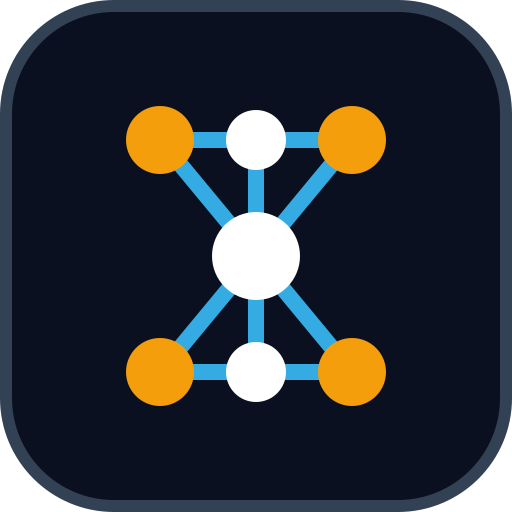

<p align="center"></p>

<h1 align="center">Idrak</h1>

<p align="center"><b>Deep learning in pure .NET. Every GPU. No native dependencies.</b></p>

> **Idrak** (Arabic: **إدراك**, pronounced *id-RAAK*) means **perception, comprehension, awareness**: taking in the world
> and coming to understand it. The name fits a library whose models learn to perceive patterns in data, to see images,
> to hear speech and to understand language.
>
> <p dir="rtl" lang="ar"><b>إدراك</b>: الفهم والوعي، والقدرة على استيعاب الأشياء ومعرفة حقيقتها. اخترنا هذا الاسم لأن المكتبة تُعلِّم النماذج أن تُدرِك الأنماط في البيانات، وأن ترى الصور، وتسمع الأصوات، وتفهم اللغة.</p>

Idrak is a neural network library for **.NET 10**, written entirely in C#.

- **Nothing native to install.** No PyTorch, no CUDA Toolkit, no cuBLAS or cuDNN, no shader compiler. Its GPU kernels
  are generated in C# (PTX for NVIDIA, SPIR-V for Vulkan, HIP source for AMD) and compiled by the GPU's own driver on
  the user's machine.
- **Every GPU, one code base.** CUDA, Vulkan and HIP devices beside SIMD CPU kernels on x64 and ARM64 (Windows, Linux,
  macOS, Android). Kernel choices are measured on the device at run time, never looked up by a card's name.
- **Build and train.** Tensors with automatic differentiation; dense, convolutional, recurrent, attention and
  transformer layers; losses, optimizers and schedules; trainers, mixed precision and data loaders for data that does
  not fit in memory.
- **Run real models.** Language, vision-language, speech, encoder and encoder-decoder models from Hugging Face folders
  or GGUF files, with their own tokenizers and chat templates. The model families live in three plug-in packages
  (`Idrak.Text.Plugins`, `Idrak.Vision.Plugins`, `Idrak.Audio.Plugins`) that the `idrak` tool registers for you.
- **Tune, serve and ship.** LoRA, QLoRA and DoRA fine-tuning, distillation and evaluation; an inference engine with
  batching, OpenAI-compatible and MCP front ends; retrieval and RAG; ONNX export and import; and one command-line tool,
  `idrak`, over all of it.
- **Open by contract.** Every behaviour goes through a contract with a registry, so a model family, a file format, a
  device or a kernel is added from a plug-in without touching the library.

This file is the library's map: what it can do today, on which hardware that was verified, how it is laid out, what
the next version should be, and what is planned. The plans under `plans/` hold the detail and the dated run records.

**State (2026-10-18):** version `0.3.1` on NuGet; the `abstraction` branch (this one) carries the unreleased `0.4.0`
work described below and in `CHANGELOG.md`. 13 packages, 824 registered tests, 18 plug-in registry kinds.

---

## Packages

All packages build from this repository and share one version. `dotnet add package Idrak` brings `Idrak.Abstraction`
and `Idrak.Gpu` along; the others are added by domain.

| Package | What it holds |
|---|---|
| `Idrak.Abstraction` | The contracts the library is built on, each with its default implementation: `Tensor`, `Autograd`, `Module`, devices and the CPU device (the host fallback of every other device), optimizers and schedules, telemetry, tokenizers, chat and tools, serving contracts, sample sources, the `SlotTable` registries. Reference it alone to write a plug-in. |
| `Idrak` | Layers and networks, training (`Trainer`, callbacks, mixed precision, activation checkpointing), datasets and loaders, model loading (safetensors, GGUF, PyTorch zip, PEFT adapters), packed weights (bfloat16, int8, int4), ONNX export and import, the inference engine, model packages (`.ikm`). |
| `Idrak.Gpu` | The GPU devices: CUDA (driver API, PTX generated in C#), Vulkan (SPIR-V generated in C#), HIP (hipRTC). Loads the driver installed on the machine; no native files of its own. Kernel tuning per size class with a persisted cache. |
| `Idrak.Data` | Row datasets: JSON Lines, JSON, CSV, TSV, text, code and Parquet; archives and compressed files; sources file, folder, http, Hugging Face, GitHub, Kaggle, Zenodo; filter, map, shuffle, deduplicate, split, mix; chat transcripts for fine-tuning; the Hugging Face model downloader. |
| `Idrak.Text` | Text generation and chat with tools, the models' own Jinja chat templates, tool-call formats, LLM fine-tuning (LoRA, QLoRA, DoRA, full), distillation, evaluation, retrieval and RAG, synthetic training pages, the coding agent, the engine's text and chat models. |
| `Idrak.Imaging` | PNG, JPEG, BMP and Netpbm codecs; Pillow's resampling, filters and enhancements byte for byte; model preprocessors on the device; a font engine (TrueType, CFF, OpenType shaping, bidi) for rendering text; image transforms and augmentations; image-folder datasets. |
| `Idrak.Vision` | Image model families (classifiers, detectors, segmenters), region classification in batches, content framing, channel statistics, detection and segmentation over any network, CTC decoding for OCR. |
| `Idrak.Audio` | WAV, FLAC and MP3 decoding and WAV and MP3 encoding in C#; resampling, STFT and log-mel features; speech recognition and synthesis contracts; vocoders, speaker encoders, voice conversion and voice stores; speech training (CTC, seq2seq, TTS, adversarial synthesis) with the library's HiFi-GAN, WaveNet and flow layers. |
| `Idrak.Text.Plugins` | The text model families as plug-ins on the public API, one namespace per family; `TextPlugins.RegisterAll()` registers them. |
| `Idrak.Vision.Plugins` | The vision model families (vision-language towers, image models, line recognizers) as plug-ins; `VisionPlugins.RegisterAll()`. |
| `Idrak.Audio.Plugins` | The speech and voice model families (recognition, synthesis, voice conversion) as plug-ins; `AudioPlugins.RegisterAll()`. |
| `Idrak.AspNetCore` | Predictions, generation, chat and an OpenAI-compatible `/v1` API (chat completions, embeddings) as thin endpoints over the inference engine. |
| `Idrak.Mcp` | Model Context Protocol: MCP servers' tools in conversations, and the engine's models served as the MCP tools `generate`, `chat` and `embed`. |
| `Idrak.Onnx.Runtime` | Runs ONNX models with ONNX Runtime as Idrak modules, so they serve through the same engine and endpoints. |
| `Idrak.Abstraction.Testing` | The conformance and stress kit: checks a device, a sampler, a tokenizer, a RoPE scaling, a codec, a recognizer or a synthesizer against the library default on fixed and random cases, and replays saved regression cases. |
| `Idrak.Cli` | The `idrak` tool (`dotnet tool install --global Idrak.Cli`). |

---

## What the library does

### Tensors, autograd and devices

- Float32 tensors with shapes, strides, slices, views, broadcasting, in-place updates and a reverse-mode autograd with
  user-defined differentiable functions. Mixed precision (bfloat16 products on the devices that have tensor cores),
  activation checkpointing, scoped allocation (`TensorScope`) and pooled device memory that is measured, not guessed.
- One `Backend` contract behind every device; every kernel has a CPU implementation (the host fallback), so any model
  runs anywhere .NET 10 runs and a device only has to be faster.
- **CPU:** `Vector<T>` SIMD (AVX2, AVX-512, NEON), a register-blocked matrix product, multi-threading for large
  tensors.
- **CUDA:** the driver API through P/Invoke, every kernel written as PTX in C# and compiled by the driver at first
  use; tensor-core products; a per-device kernel tuning that measures candidate layouts per size class and lends a
  neighbouring class's choice until it measures its own; a persisted tuning cache.
- **Vulkan:** SPIR-V generated in C# for any Vulkan 1.1 device (discrete, integrated or software), subgroup or
  workgroup-memory reductions chosen per device, the same tuning.
- **HIP:** the AMD ROCm path, compiled at run time with hipRTC; builds and runs against a host stand-in, not yet tested
  on real hardware.
- Nothing is tuned for a card: devices report their limits and the library measures what it uses. Limits, when a user
  wants them, are `ComputeResources` options, each with an environment variable (`idrak env` lists them all).
- Telemetry: layered events (operations, devices, kernel tunings, batches, epochs, generation) to a console logger, a
  JSON Lines file or a channel; a GPU profiler; `idrak trace`, `idrak profile`, `idrak memory`.

### Layers and training

- Linear, embeddings, 1-D and 2-D convolutions (rectangular, strided, dilated, grouped, transposed), pooling (max,
  average, adaptive, ceil mode), upsampling, normalizations (layer, RMS, group, batch), LSTM and GRU (stacked,
  bidirectional), attention (multi-head, grouped-query, relative-position, cross), rotary positions with the
  `dynamic`, `linear`, `llama3` and `yarn` scalings, mixture-of-experts feed-forwards, weight-norm parametrization,
  flows (rational-quadratic splines, residual coupling), WaveNet and HiFi-GAN blocks, GAN and feature-matching losses,
  CTC loss, monotonic alignment, a differentiable log-mel.
- A network builder and `GraphModule` for arbitrary graphs; 31 layer types and 36 graph operations are registered and
  any plug-in adds more.
- Optimizers: SGD, Adam, AdamW, AdamW 8-bit, grouped and host optimizers; schedules step, exponential, cosine, lambda.
- `Trainer` with callbacks, metrics, history, early stopping, checkpoints resumed bit for bit, out-of-memory recovery
  (micro-batches halved and retried), sample sources and streams with transforms and bucketed batching.
- Run tracking: `idrak runs list|show|compare`, `idrak resume`, `idrak report`.

### Language models

- Families: the plug-in package `Idrak.Text.Plugins` (`TextPlugins.RegisterAll()`; the `idrak` tool registers it):
  Llama, Mistral, Mixtral, Qwen2, Qwen2-MoE, Qwen3, Qwen3-MoE (GGUF architectures llama, qwen2, qwen2moe, qwen3,
  qwen3moe), Gemma, Gemma 2 and Gemma 3 (GGUF gemma, gemma2, gemma3), BERT and T5, one namespace each; the library
  registers none. A family nobody
  registered fails loudly with "not registered" and is added as a plug-in (`PretrainedFamilies`, `GgufArchitectures`).
- Checkpoints: safetensors, GGUF (every ggml quantization dequantized or run packed), PyTorch zip read without running
  it; PEFT adapter folders (LoRA, DoRA, rsLoRA) loaded or merged; packed weights bfloat16, int8, int4; KV caches in
  bfloat16, float32 or int8.
- Tokenizers: BPE from `tokenizer.json` or GGUF with the registered normalizers, pre-tokenizers and decoders; a BPE
  trainer (`idrak data tokenizer`).
- Generation: a device-side decoding step (sampling, penalties, token history, RoPE and norms as kernels, the host
  waits once per read of the sampled tokens), batching, streaming, string stops, temperature, top-k, top-p, min-p,
  repetition penalties; the kit checks every device's draws against the CPU's.
- Chat: the model's own Jinja template, tool calling in the `json`, `pythonic`, `qwen3-coder`, `mistral`, `harmony`
  and `deepseek` formats, server-side tool rounds for any chat model, MCP tools, conversations with memory.
- Fine-tuning: LoRA, QLoRA (int4 base), DoRA, full tuning; chat and completion objectives; distillation from a
  teacher model or saved distributions; `idrak tune`, `idrak distill`, `idrak merge`, `idrak quantize`.
- Pre-training from scratch: `idrak pretrain` over the decoder spec, with `idrak data tokens`.
- Evaluation: perplexity, answer metrics (exact match, F1, CER, WER, contains), `idrak eval`, `idrak perplexity`,
  `idrak compare`.
- Retrieval and RAG: embedders, BM25 and vector indexes, rerankers, chunking, fusion; `idrak rag index|search|ask|eval`.
- A coding agent (`idrak agent`) with tools over the file system and shell.

### Vision and vision-language

- Images decoded in C# (PNG, JPEG, BMP, Netpbm), Pillow-exact transforms and a libjpeg-turbo-exact JPEG encoder, so
  preprocessing matches the Python references byte for byte; preprocessors run on the device.
- Classifiers, detectors and segmenters from checkpoints; region classification, content framing, non-maximum
  suppression, segmentation masks and metrics; connected components and foreground extraction.
- Vision-language: image tokens in the decoder, a SigLIP encoder and projector, pan-and-scan crops, per-request vision
  options; Gemma 3 vision, Qwen-VL, LLaVA and a from-scratch family `IdrakVision` in the plug-in package
  `Idrak.Vision.Plugins` (with the CRNN line recognizer); images in `idrak chat`, `idrak serve` (`/v1` `image_url`, multipart,
  `/api/chat`).
- OCR: CTC models, the Arabic and legal OCR samples, `idrak vlm check`.
- Synthetic training pages: the library's own font engine (TrueType and CFF outlines, every GSUB and GPOS lookup
  kind, HarfBuzz-exact shaping on the checked strings, UAX #9 bidi), text layout with wrapping, justification and
  fallback fonts, page layouts, and about fifty seeded scan and paper effects (`idrak data synth`, `idrak data text`,
  `idrak data fonts`).

### Audio and speech

- Codecs: WAV (PCM 8 to 32 bits, float, extensible), FLAC, MP3 and MP2 decoding; WAV and MP3 encoding (MPEG-1 and
  MPEG-2 Layer III, constant bit rate). Decoded audio is held as 16-bit until its floats are read.
- Features: resampling, STFT and inverse STFT, mel filterbanks, log-mel features, Griffin-Lim; a feature cache for
  training.
- Recognition: the Whisper plug-in (`Idrak.Audio.Plugins.Whisper`) matching transformers' encoder output and logits within
  1e-4 and its greedy, beam and timestamp ids exactly; CTC models trained from scratch; `idrak transcribe`.
- Synthesis: the VITS plug-in (`Idrak.Audio.Plugins.Vits`; MMS voices, Arabic romanisation matching uroman exactly),
  the OpenVoice tone-colour converter (`Idrak.Audio.Plugins.OpenVoice`), voices installed by name (`idrak voice
  add|pull|import|export|list|show|remove`), `idrak speak`.
- Speech training (`SpeechTrainer`, one loop for every objective): CTC, sequence-to-sequence, audio-language and TTS
  from scratch, and adversarial fine-tuning of a VITS voice from a few minutes of a speaker (`idrak voice train`:
  the losses, pace and device memory on one live line, checkpoints resumed, held-out scoring).
- Audio in chat (`--audio`, audio parts in tuning data), `idrak data audio` (clip, align, draft transcripts with
  Whisper), `idrak data mel`.

### Serving

- The inference engine: named models of any kind (`predictor`, `text`, `chat`, `embed`, or a plug-in's), leases,
  batchers, a model catalog, descriptions, keep-alive, status.
- ASP.NET Core endpoints and the OpenAI-compatible `/v1` API; API keys (`idrak server keys`); `idrak serve`,
  `idrak server load|unload|ps|stop`, `idrak api`, `idrak ui`.
- MCP in both directions (`idrak mcp serve`, `idrak serve --mcp`, `idrak tools list|test`).
- Model packages (`.ikm`) with `idrak package`, `idrak inspect`, `idrak verify`; ONNX export and import
  (`idrak onnx export|import|check`) with registered translators; ONNX Runtime execution.

### Plug-ins and conformance

Every extension point is a contract plus a `SlotTable` registry; a plug-in is an assembly loaded with `-P path.dll` or
the config's `plugins`. `idrak plugins list` prints what is registered:

| Registry | Built in |
|---|---|
| Device kinds | cpu, cuda, vulkan, hip |
| Weight formats | bfloat16, int8, int4 |
| KV cache formats | bfloat16, float32, int8 |
| Checkpoint formats | safetensors, gguf, pytorch |
| Dataset file formats | Code, Csv, Json, JsonLines, Parquet, Text, Tsv |
| Dataset sources | file, folder, github, hf, http, kaggle, zenodo |
| Tool-call formats | deepseek, harmony, json, mistral, pythonic, qwen3-coder |
| Model families | 11 (above) |
| GGUF architectures | 8 (above) |
| RoPE scalings | dynamic, linear, llama3, yarn |
| Graph operations | 36 |
| Layer types | 31 |
| ONNX import operators | 23 |
| Audio codecs | flac, mp3, wav |
| Audio encoders | mp3, wav |
| Audio feature extractors | log-mel |
| Vocoders | griffin-lim |
| Audio splitters | silence, seconds |

Also registered through the same mechanism: chat templates, tokenizer components, pretrained families, image codecs
and transforms, image encoders, speech sources, speech training objectives, augmentations, voice converters, voice
stores, speaker encoders, samplers, engine model kinds and telemetry hooks.

`Idrak.Abstraction.Testing` checks any implementation against the library default: `DeviceCases` (every kernel, fixed
and random shapes, sampling over small and large vocabularies), stress (threads, long runs, odd shapes, cancellation,
memory growth) and saved regression cases. `idrak check` runs the device kit; `idrak test` the library's test list.

---

## Hardware status

| Device | State | Verified on |
|---|---|---|
| CPU | supported everywhere .NET 10 runs | Windows 11 (4 to 24 threads), Ubuntu; the full CPU test list |
| NVIDIA, CUDA | supported from compute 5.0 | compute 12.0 and 8.6 GPUs (plan 1); the kit, the benches and training runs, 2026-10 |
| Any Vulkan 1.1 GPU | supported | the same NVIDIA GPUs through Vulkan, and lavapipe (software) on Linux; the kit passes on both |
| AMD, HIP | built, inert where ROCm is absent | not yet run on real hardware (plan 8) |
| AMD, Intel, Apple GPUs | run on the CPU today | plans 3, 4, 5 not started; Vulkan is the planned route for AMD and Intel |

The GPUs are named here as the record of what has been run, not as targets: nothing in the code or the tuning refers to
a card. The records with numbers are in `plans/22-performance-and-library.md` (benches), `plans/1-nvidia.md`,
`plans/17-vision-ocr-speed.md` and `plans/21-audio.md`.

Measured this month on the owner's card (CUDA unless said), from the benches in `benches/Idrak.Benches`:

| Bench | Result |
|---|---|
| `train-decoder`, medium, float32 | 490 ms a step, 8,350 tokens/s |
| `train-decoder`, medium, bfloat16 products | 127 ms a step, 32,300 tokens/s |
| `train-speech`, VITS fine-tuning step, one clip / eight clips | 0.14 s / 0.17 s warm (was 3.5 s and 28 s before the tuning lends across size classes) |
| `voice train`, a real voice from mms-tts-ara | about 215x real time, 1.1 to 1.7 s a step |
| `launch`, the host's cost a kernel launch | CUDA 6.7 µs (the driver's launch call itself), Vulkan 0.8 µs, CPU 0.1 to 0.5 µs; the library adds nothing measurable |
| Vulkan axis sum over the last axis, 1M elements | 105 → 11 µs after the row kernel |

---

## The command line

`idrak` is one tool with these command groups (`idrak --help`, `idrak explain COMMAND`, `idrak env` for every
environment variable with its scope):

| Group | Commands |
|---|---|
| Devices and health | `devices`, `check`, `doctor`, `kernels`, `kernels dump`, `tuning show`, `tune init`, `memory`, `profile`, `trace`, `bench`, `compare`, `version`, `update`, `setup android` |
| Models | `pull`, `list`, `show`, `rm`, `search`, `inspect`, `verify`, `convert`, `quantize`, `merge`, `package`, `families`, `formats`, `overrides`, `cache info`, `cache clear`, `login`, `logout` |
| Generation | `chat`, `complete`, `run`, `batch`, `embed`, `tokenize`, `template`, `predict`, `agent`, `suggest`, `shell`, `demo` |
| Training | `train`, `tune`, `pretrain`, `pretrain init`, `distill`, `resume`, `eval`, `perplexity`, `diff`, `runs list`, `runs show`, `runs compare`, `report`, `viz` |
| Data | `data preview`, `stats`, `validate`, `convert`, `dedupe`, `split`, `mix`, `sample`, `tokens`, `tokenizer`, `synth`, `text`, `fonts`, `audio`, `mel` |
| Retrieval | `rag index`, `rag search`, `rag ask`, `rag eval` |
| Speech | `transcribe`, `speak`, `voice add`, `voice pull`, `voice import`, `voice export`, `voice list`, `voice show`, `voice remove`, `voice train` |
| Vision | `vlm check` |
| Serving | `serve`, `api`, `ui`, `ping`, `server load`, `server unload`, `server ps`, `server stop`, `server keys add`, `list`, `rm`, `mcp serve`, `tools list`, `tools test` |
| Interchange | `onnx export`, `onnx import`, `onnx check`, `create`, `create init`, `new`, `init` |
| Configuration | `config get`, `set`, `list`, `unset`, `alias set`, `list`, `rm`, `env`, `env set`, `env unset`, `env reset`, `plugins list`, `completion`, `test` |

Every command takes `-d DEVICE` (`cpu`, `cuda`, `cuda:1`, `vulkan`, ...), `-P PLUGIN.dll`, `-v` and `--json`.

---

## Building and testing

Requirements: the .NET 10 SDK. Nothing else; the GPU devices load the driver already installed on the machine.

```powershell
dotnet build -c Release tests\Idrak.Tests
```

Tests are a single program with a filter. Run a group, never the whole list on a shared machine:

```powershell
$env:IDRAK_DEVICES = "cpu"; $env:IDRAK_FILTER = "audio codecs"; dotnet run -c Release --no-build --project tests\Idrak.Tests
$env:IDRAK_DEVICES = "cuda"; $env:IDRAK_FILTER = "sampler"; dotnet run -c Release --no-build --project tests\Idrak.Tests
```

`IDRAK_UPDATE_API=1` regenerates the public API dumps in `api/` (the guard test fails on an unreviewed change);
`IDRAK_UPDATE_INVENTORY=1` regenerates `plans/10-abstraction-inventory.md`. The benches:

```powershell
dotnet run -c Release --project benches\Idrak.Benches -- ops matmul launch train-decoder infer-decoder train-speech memory
dotnet run -c Release --project benches\Idrak.Benches -- compare before.json after.json
```

Working rules for this repository are in `CLAUDE.md`; the performance rules in `docs/optimization.md`.

---

## Repository layout

| Path | Contents |
|---|---|
| `src/` | the 13 packages |
| `tests/Idrak.Tests`, `tests/Idrak.PluginTests` | the test program (824 tests, filtered by group) and the plug-in tests |
| `benches/Idrak.Benches` | the benches above |
| `samples/` | plug-ins (QwenVision, IdrakVision) and 24 sample apps (chat, coding agent, GPT API and training, house prices, OCR and legal OCR, quantization, RAG, re-ranker, sentiment, shape recognition, summarizer, text generation, ONNX import, ...) |
| `api/` | the public API dumps the guard test checks |
| `plans/` | one plan per area with its status and dated runs; `plug-in.md` the extensibility survey; `idrak-cli.md` the CLI design; `gpu-checks.md` the GPU check list |
| `docs/` | `optimization.md` and the longer guides |
| `tools/` | fixture makers (Python references the tests compare against: uroman, HarfBuzz, torch losses, ffmpeg) |

---

## Which version comes next: 0.4.0

The branch holds one breaking release, and it should ship as **0.4.0**, not as a 0.3.x patch:

- `Idrak.Abstraction` is new and every shared type moved into it (the table in `CHANGELOG.md`); packages were regrouped
  by domain (`Idrak.Datasets` → `Idrak.Data`, `Idrak.LanguageModels` retired into `Idrak` and `Idrak.Nlp` (renamed `Idrak.Text` in 2026-10), `Idrak.Onnx`
  folded into `Idrak`, `Idrak.Vision`, `Idrak.Gpu`, `Idrak.Imaging`, `Idrak.Audio` new). Plug-ins compiled against
  0.3.x must be rebuilt: that is a minor bump under 0.x semantics.
- The engine reaches models only through contracts (`engine.Model<IChatModel>(name)`), with no shims for the old
  calls.
- MP3 is now built into `Idrak.Audio`; the `Idrak.Mp3Audio` sample plug-in is gone.

Not 1.0 yet: the HIP device is untested on hardware, only NVIDIA GPUs have run the GPU paths, and plan 10's inventory
still lists contracts whose only implementation is the built-in one. `VersionPrefix` stays `0.3.1` until the owner
tags; the `CHANGELOG.md` section "Unreleased (0.4.0)" is the release note.

Before the tag: the owner's GPU runs of the targeted groups that changed (`tuning`, `sampler`, `audio`, the kit), the
S8 route C result recorded in plan 21, and a `dotnet pack` of the 13 packages.

---

## Planned features

Ordered by how soon they are likely to matter; each has a plan with the detail.

**Near (in progress or next)**

- **Speech (plan 21):** close S8 with the route C voice from the fixed trainer (the run is under way); sampling with
  the temperature fallback and segment batches in Whisper's `Transcribe`; the hiss in pauses of the fine-tuned voice.
- **Performance (plan 22):** a training step recorded as a device graph and replayed, with batches padded to size
  classes so shapes repeat (the only way below the driver's cost per launch); CPU `exp` and `erf` kernels; the
  remaining fixed policy constants reviewed.
- **Vision-language (plans 11, 12, 16, 19):** phase 6 of plan 11 (the owner's choice to stop); the owner's runs of the
  real models and the from-scratch IdrakVision family on the card (plan 19 A5 and B6).
- **Extensibility gaps still open from `plans/plug-in.md`:** 7 (model packages storing custom architectures, scalers
  and tokenizers), 11 (tokenizer models beyond BPE: WordPiece, Unigram/SentencePiece), 12 (GGUF families unlike
  Llama), 13 (generation hooks: stopping criteria, logits processors, speculative decoding, structured output), 15
  (full metrics, optimizer state in checkpoints), 16 (evaluation metrics as a registry), 17 (more engine model kinds
  and options), 18 (retrieval pooling, chunking, indexes and fusion as registries), 19 (registered dataset formats
  when picking hub files; compression and archives), 20 (safetensors FP8 and int8 dtypes), 21 (checkpoint export for
  every module and format), 22 (first-class packed-weight plug-ins), 23 (Jinja filters and tests), 24 (initializers,
  activations and precisions), 25 (structured and image tool results).

**Later**

- **Diffusion (plan 20):** the package `Idrak.Diffusion` is reserved and nothing is built: UNet and DiT denoisers,
  schedulers, VAE, text conditioning, image and audio generation.
- **AMD GPUs (plans 3 and 8):** the HIP device on real hardware, and the Vulkan device verified on Radeon.
- **Intel GPUs and NPUs (plan 4):** Vulkan on Iris Xe and Arc; the NPU after.
- **Apple silicon (plan 5):** a Metal device; macOS CPU runs first.
- **More than one device (plan 6):** a model or a training job over several GPUs and machines; a serving tier over
  several hosts.
- **Operations (plan 9):** phases 0 and 2 to 5 of the descriptor-driven kernel dispatcher (fusion, scheduling).

---

## License

Apache License 2.0. Copyright (c) 2026 Ahmed Seada.
